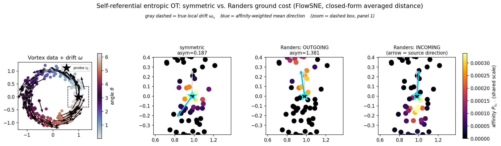
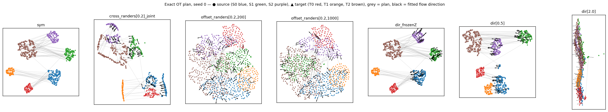
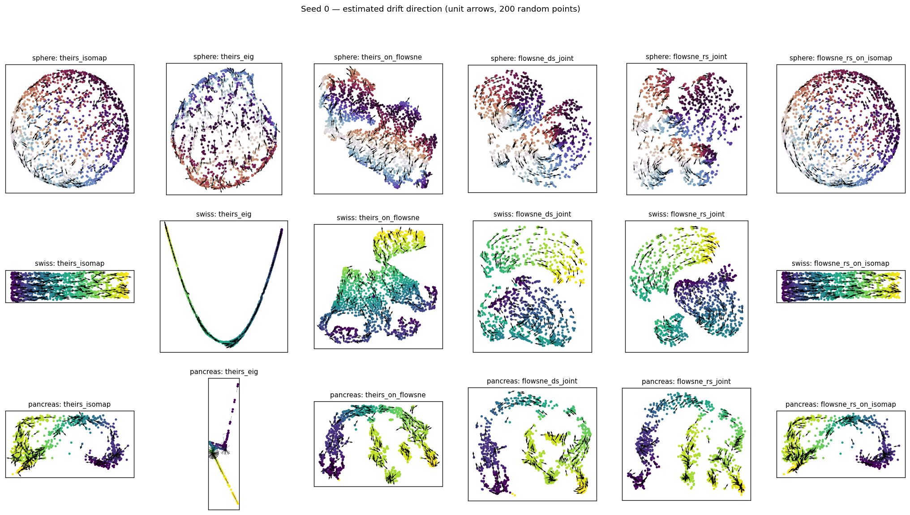
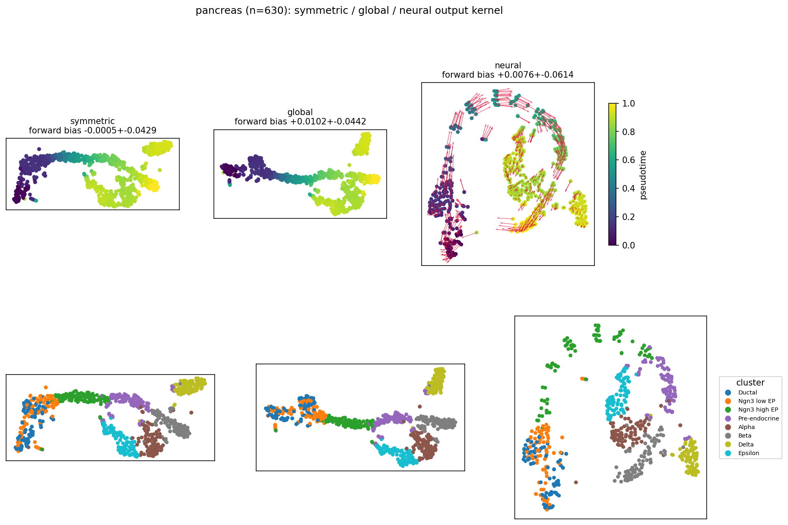

# FlowSNE — working draft

*Status document, 7 October 2026. Branch `ot-and-baseline-studies` at `7ff4712`.
Venue not chosen yet. Every number below comes from a committed result file
(paths in §8). Where a result is old or weak, that is stated next to it.*

---

## 1. The problem

Neighbour-embedding methods (SNE, t-SNE, UMAP, SNEkhorn) build an affinity
between points from a **symmetric** ground cost. Many datasets, though, come
with a **direction** at each point:

- RNA velocity in single-cell data,
- the gradient of a loss with respect to a network's activations,
- the velocity field of a flow-matching generative model,
- the displacement given by an optimal-transport plan.

A symmetric cost cannot represent "cheaper to move with the flow than against
it", so the embedding throws the direction away. The usual workaround is to
draw arrows *after* the fact, by projecting the velocities onto a layout that
never saw them (scVelo's velocity embedding, for example).

**Goal:** a neighbour embedding whose affinity is built from a
direction-dependent (Finsler, here Randers) ground cost, together with a
direction field fitted in the embedding, so that the 2-D picture respects both
the local structure and the flow.

## 2. Our approach: FlowSNE

### 2.1 Ground cost from per-point velocities

A Randers metric `F(x, v) = |v| + ω(x)ᵀv`, with `|ω| < 1`, gives a
direction-dependent distance `d_F(x→y)`. The exact distance is a minimum over
paths and has no closed form when ω varies with position. Since our input is a
velocity *per point*, we use two straight-line closed forms:

| | formula | error | exact when |
|---|---|---|---|
| frozen | `‖y−x‖ + ω(x)ᵀ(y−x)` | O(L r²) | ω constant |
| averaged (default) | `‖y−x‖ + ½(ω(x)+ω(y))ᵀ(y−x)` | O((L² + L₂) r³) | ω affine |

Here r = |y−x|, L is the Lipschitz constant of ω and L₂ bounds its second
derivative. Both forms cost the same.

**Checked numerically** (Study A, gradient fields in 50-D, where the exact
distance is known). Median relative error over each point's √n nearest
neighbours, at ‖ω‖ ≤ 0.6:

| field | frozen | averaged |
|---|---|---|
| convex potential | 1.5e-2 | 1.1e-4 |
| non-convex potential | 2.3e-2 | 5.7e-3 |

The averaged form is about 100× more accurate when the potential is close to
quadratic, and about 4× otherwise.

Both forms are computed with (n, n) matrix products only. The averaged drift
term rearranges to `½[(ΩZᵀ − ZΩᵀ)_ij + s_j − s_i]`, with `s_i = ω_i·z_i`.
This drift term is exactly **antisymmetric**: `bdF` is a symmetric distance
plus an antisymmetric tilt.

### 2.2 Input affinity: `EntropicRandersAffinity`

1. Cost: `C_ij = d_F(x_i→x_j)²`, with the given drift rescaled globally so that
   its largest norm is ρ = 0.95.
2. Each row's bandwidth is found by bisection to hit a target perplexity
   (default √n, which keeps the neighbourhood a fixed fraction of the data as
   n grows).
3. Then either:
   - Sinkhorn-balanced to uniform marginals (**DS**, SNEkhorn's construction),
     or
   - left row-stochastic (**RS**).

### 2.3 Output kernel and fitting: `RandersAffinity`

- **Kernel:** a Student-t kernel on the embedding, using the same averaged
  Randers distance, with drift `ω_θ(z)` produced by a **pluggable network**.
  The network's last layer starts at zero, so a fit begins from the symmetric
  kernel.
- **Why the output must be asymmetric too:** a cross-entropy against a
  symmetric output kernel only ever sees P + Pᵀ, so it cannot express
  direction.
- **Fitting:**
  - **joint:** layout Z and flow parameters θ fitted together;
  - **drift-only:** fit the symmetric layout first, freeze it, then fit only
    the flow.
- **Sign convention:** under `|dz| + ωᵀdz`, moving *along* ω costs more. The
  direction to plot is therefore −ω_θ.

## 3. What a Randers affinity can see: gauge and attenuation

This is the main conceptual finding so far, and the best candidate for a
formal statement.

**Proposition (exact gauge).** Assume:
- the drift is a gradient field, ω = ∇φ with |∇φ| < 1;
- the cost is linear: `d_F(x→y) = |y−x| + φ(y) − φ(x)`, which is exact,
  because straight lines are geodesics when the drift integrates to a potential
  difference;
- one global ε for the whole kernel.

Then `exp(−d_F/ε) = diag(e^{φ/ε}) · exp(−|·|/ε) · diag(e^{−φ/ε})`. The
diagonal scalings are absorbed by Sinkhorn's own scalings. So the balanced
coupling is **identical** to the symmetric one, for any marginals: a gradient
drift is pure gauge.

Two remarks:
- Convexity is not needed for the exact distance. What convexity buys is that
  the frozen form becomes a lower bound.
- Optimal-transport displacements are gradients (Brenier), so this applies
  directly to OT flows.

**Measured (Study A, 1000 points in 50-D, 3 seeds, ρ = 0.6).**
- `chg` = ‖P − P_sym‖₁ / ‖P_sym‖₁.
- `align` = cosine between the shift in each point's mean outgoing
  displacement and the true drift.

| drift | DS, averaged (our default) | DS, exact | RS, averaged | linear cost, global ε, exact |
|---|---|---|---|---|
| gradient, convex φ | chg 0.031 / align +0.06 | 0.031 / +0.06 | 0.060 / **+0.32** | **0.000 / 0.00** |
| gradient, non-convex φ | 0.049 / +0.12 | 0.048 / +0.06 | 0.097 / +0.24 | **0.000 / 0.00** |
| rotation (no potential) | 0.079 / **+0.37** | – | 0.100 / +0.51 | (averaged: 0.088 / +0.56) |

- The prediction holds exactly: 0.000 for every seed and every drift strength.
- Our DS default is mostly blind to gradient drifts (+0.06) but sees rotational
  ones (+0.37). RS sees gradient drifts about five times better.
- In the gauge setting, any signal a closed-form approximation shows for a
  gradient drift is approximation error: for example +0.24 for the averaged
  form on the non-convex field, against exactly 0 for the exact distance.
- **Helmholtz reading:** with balanced marginals, the curl-free part of a drift
  amounts to a reweighting of where mass goes, which fixing the marginals
  undoes. The divergence-free part is the genuinely directional signal.

**Correction from the baseline study (§5): attenuation, not erasure.**
Squaring the cost and using per-row bandwidths both break the exact
factorisation. A fitted flow network can then still recover a gradient drift's
direction from the weak leftover signal: the DS joint fit reaches cos 0.98 on a
Swiss roll whose drift is a gradient. The accurate claim is:
- exact invariance for a linear cost with a global ε;
- attenuation otherwise.

The attenuation has a measurable cost on real data. On pancreas, RS beats DS
by 0.80 vs 0.69 in direction and 0.76 vs 0.54 in agreement with scVelo.
**Recommendation:** RS by default for velocity data.

*Figure 1 candidate. Around a probe point on a vortex:*
- *the symmetric affinity has no preferred direction (asymmetry 0.19);*
- *with the Randers cost, the outgoing neighbourhood moves downstream and the
  incoming one upstream (asymmetry 1.38).*

## 4. Extension: visualising an optimal-transport plan

**Setting.** A source and a target distribution in high dimension, an exact OT
plan between them (EMD), and the plan's displacements used as velocities. We
want a 2-D picture where:
- source and target are clearly distinct;
- the flow matches the high-dimensional transport.

Test problem: 450 + 450 points in 50-D, 3 + 3 clusters, built so the plan
contains a **split** (S0 → T0 + T1) and a **merge** (S1 + S2 → T2). 3 seeds.

**Attempts:**

1. **Plan as drift only: fails.** Within a cluster the plan's displacement is
   nearly constant, which is a gradient field and therefore close to pure gauge
   (§3). The flow aligns with the true partner at +0.18 to +0.23, against a
   random-partner control at +0.11 to +0.13.
2. **Plan as a directed cross-affinity**, `P = (1−α)·P_union + α·π` with π
   placed as a source→target block. α trades separation against faithfulness:

   | α | layout | plan kept at cluster level | flow: true partner / wrong cluster |
   |---|---|---|---|
   | 0.05 | clean, t-SNE-like | 0.95 | 0.90 / 0.70 |
   | 0.2 | source and target begin to overlap; clusters stretched | 0.94 | **0.81 / −0.05** |
   | 0.5 | collapse: each point sits on its partner | 1.00 | ≈ 0 |

3. **Artificial source–target offset D₀** in the output kernel: **fails,
   instructively.** For large D₀, q_ij ≈ 1/D₀² for *every* cross pair
   regardless of position. The repulsion that keeps the two distributions apart
   in t-SNE disappears, and they interpenetrate. The fraction of
   other-distribution neighbours rises from 0 to 0.16–0.42, largely
   independently of D₀ ∈ {50, 200, 1000}.
4. **Direction-only cross term: works.** P keeps only within-distribution
   affinities. The plan enters through a separate loss: for each source point,
   a softmax over all target points of κ·cos(flow(z_i), z_j − z_i), trained to
   select its OT partner (and the mirror term for target points). This is the
   angular part of the Randers term with the magnitude dropped. Being
   scale-free, it cannot attract partners together.

   | | t-SNE | cross α = 0.05 | **direction-only, λ = 0.5** | direction-only, λ = 2 |
   |---|---|---|---|---|
   | other-distribution neighbours | 0.000 | 0.000 | **0.000** | 0.41 |
   | kNN preservation | 0.68 | 0.68 | **0.66** | 0.34 |
   | plan kept at cluster level | 0.86 | 0.95 | **0.95** | 0.91 |
   | fine correspondence (R²) | 0.31 | 0.33 | **0.43** | 0.91 |
   | flow → true partner / wrong cluster | – | – | **0.94 / 0.49** | 0.96 / 0.03 |

   At λ = 0.5:
   - source and target stay separated and local structure is close to t-SNE's;
   - the cluster-level plan is fully preserved;
   - the fine correspondence is the best of any non-collapsed layout;
   - the flow is clearly partner-specific.

   At λ = 2 the layout degenerates into a near-line.

   Open issues:
   - λ = 0.1, and the control with a frozen layout, are unstable across seeds
     (std 0.4–0.8), which points to an optimisation-budget problem;
   - this term is a loss added to t-SNE, not an affinity, so it should be
     presented as its own construction.

## 5. Comparison with Debaussart-Joniec, Blanchard & Kalogeratos (arXiv 2609.37649, 29 Sep 2026)

### 5.1 Their method

- **Input:** directed distances `d_F(X_i, X_j)`, or a weighted directed graph.
- **Construction:** spectral, diffusion-maps style. They build
  `W = K(d_F/ε)` on a kNN graph, apply θ-normalisation, and split W into
  symmetric and antisymmetric parts.
- **Main theorem:** as ε → 0,
  - the symmetric part converges to a weighted Laplacian of the Binet–Legendre
    metric;
  - the antisymmetric part converges to a first-order transport along the
    **centroid field** of the Finsler unit ball.
- **Further theory:** uniform almost-sure convergence of the graph operators;
  a "moment-Randers" metric that matches both limits.
- **Algorithm:**
  - embedding = Isomap, or the leading eigenvectors of the symmetric operator,
    so the layout itself is symmetric;
  - drift at each point = `V = Lᵃ Ψ`, i.e. the antisymmetric operator applied
    to the embedding coordinates.
- **Experiments:** synthetic only (a Randers Swiss roll, a Matsumoto
  height-map metric, a directed stochastic block model). No real data, no
  neighbour-embedding baselines. They do not cite SNEkhorn.
- Their repository contains `code_iclr.zip`, and the paper carries an ICLR-style
  AI statement, so it is probably an ICLR 2027 submission.

### 5.2 Conceptual differences

| | Debaussart-Joniec et al. | FlowSNE |
|---|---|---|
| family | spectral / diffusion maps | neighbour embedding (SNE / SNEkhorn) |
| input | directed distances or a directed graph | per-point velocities, through closed-form Randers distances with error bounds |
| drift in the embedding | read off a symmetric layout afterwards (`Lᵃ Ψ`) | a fitted network, jointly with the layout or drift-only |
| normalisation | θ-normalisation (Coifman–Lafon) | Sinkhorn-balanced or row-stochastic, perplexity-calibrated |
| theory | continuum limits and consistency (rigorous) | closed-form error bounds; gauge proposition (§3) |
| data | synthetic | toys, pancreas; legacy: dentate gyrus, MNIST, flow matching, GPT-2 |
| OT plans | – | §4 |

How the two relate: their antisymmetric limit is c·∇, which is non-zero for a
gradient drift, so their θ-normalised operator *does* see gradient drifts,
while a balanced Sinkhorn affinity attenuates them (§3). The choice of
normalisation determines which Helmholtz component of a drift is visible.
Deriving the Sinkhorn-balanced counterpart of their Theorem 2 would build on
their result rather than compete with it.

### 5.3 Empirical comparison

**Setup**
- Their `operators.py` is used unmodified, with their graph construction:
  symmetrised 10-NN, Gaussian kernel, ε = std of the edge distances, θ = 1.
- Both methods get the **same** input cost: averaged Randers distance, ρ = 0.9.
- 3 seeds per dataset.
- Reference drift = the true drift pushed into each embedding, `J_i ω_i`, with
  J estimated by local regression. This is the same quantity their Table 1
  uses, and it is structurally close to their own estimator. On pancreas we
  also report agreement with scVelo's own projection, which is the fairer
  measure there.

| | theirs, Isomap | theirs on FlowSNE's layout | FlowSNE DS, joint | FlowSNE RS, joint |
|---|---|---|---|---|
| **sphere vortex:** direction / speed ρ / kNN | **0.98** / 0.61 / 0.48 | 0.85 / 0.44 / 0.68 | 0.95 / **0.85** / **0.81** | 0.95 / 0.76 / 0.79 |
| **Swiss roll, gradient drift:** direction / kNN | 0.97 / **0.86** | 0.87 / 0.66 | 0.98 / 0.75 | **0.99** / 0.80 |
| **pancreas:** direction / scVelo / speed ρ / kNN | 0.81 / 0.69 / 0.63 / 0.29 | **0.88 / 0.78** / 0.50 / **0.53** | 0.69 / 0.54 / 0.64 / 0.52 | 0.80 / 0.76 / **0.79** / 0.50 |

Spread across seeds is ≤ 0.05, except for Swiss-roll speed ρ, which isn't
meaningful there because the true speed is constant.

*Pancreas re-run (8 Oct 2026).* The original run used the old Sinkhorn
default (200 iterations), which left the balanced affinity's marginals 2.6%
off on this dataset. After the fix (log-domain, converged to 1e-9), only the
DS-dependent numbers moved: DS joint speed ρ 0.70 → 0.64, their estimator on
FlowSNE's layout 0.87 → 0.88 (direction) and 0.77 → 0.78 (scVelo). The table
shows the re-run; no conclusion changed. Sphere and Swiss roll were already
converged (≤ 2e-5) and were not re-run. Their eigenvector variant
collapses to a 1-D curve on the Swiss roll and on pancreas (kNN 0.26–0.32).

**Reading**

- **Drift direction: roughly a tie.** Their estimator is best on the sphere
  (0.98 vs 0.95). FlowSNE is slightly ahead on the Swiss roll (0.99 vs 0.97).
  Their estimator costs under a second; a FlowSNE joint fit costs about
  10 minutes. **We cannot claim better drift recovery.**
- **FlowSNE wins on layout and speed.** kNN preservation is 0.81 vs 0.48 on the
  sphere and 0.50–0.53 vs 0.29 on pancreas. Speed ρ is 0.85 vs 0.61 on the
  sphere and 0.79 vs 0.63 on pancreas. The Swiss roll is the honest exception:
  Isomap unrolls it perfectly, while FlowSNE tears it into 2–3 pieces.
- **The methods complement each other.** On pancreas, their estimator on
  *our* layout has the best direction score and the best scVelo agreement. That
  hybrid is a generic "project the input graph's asymmetry onto any layout"
  recipe, structurally the same as scVelo's own arrows. It is therefore a
  strong, cheap baseline that a fitted flow must justify itself against.
- **Joint fits beat drift-only fits on the toys** (by 0.10–0.17 in direction),
  unlike on MNIST (§6). On pancreas the picture is mixed: RS joint beats RS
  drift-only (0.80 vs 0.71), but DS drift-only edges out DS joint (0.72 vs
  0.69).

## 6. Other results so far

- **Sphere vortex, n = 1500** (`experiments/toy/sphere_vortex.py`). Loss:
  - symmetric 12.17;
  - global drift 11.96;
  - input-std-norm flow 11.52, with corr(‖field‖, true speed) = +0.95;
  - RFF flow 11.62 (+0.65 at lr 0.1).

  An RFF sweep over 3 seeds × σ ∈ {0.03, 0.1, 0.3} × lr ∈ {0.1, 0.03}:
  - the best RFF (σ = 0.03, lr 0.03, 4000 iterations) reaches 11.60 / +0.80;
  - input-std-norm-32 reaches 11.55 / +0.91;
  - this reverses FinslerAffinity's ranking, most likely because the input
    affinity changed from heat kernel to entropic.

  The script still uses the older RFF setting.
- **Distance implementation:** the (n, n)-only version matches the previous
  (n, n, d) one to about 1e-15, in values and gradients. It is about 100×
  faster at n = 2000, d = 100 (0.07 s vs 7.5 s; the old version also needed a
  3.2 GB tensor).
- **Scaling (KeOps backend, sparse input affinity).** Both affinities now have
  a KeOps backend with O(n) memory, and the input affinity can be sparse (each
  row's 5 × perplexity nearest points under the directed cost). Dense and
  KeOps agree to 1e-15 in float64 on losses and gradients, and a full
  sphere-vortex fit gives the same loss (11.5931 vs 11.5930) and speed
  correlation (+0.886 vs +0.887) either way. On an RTX 2080 Ti (float32,
  k = 250): 0.020 s per fit step at 10k points (dense: 0.097 s), 0.36 s at
  100k, with peak memory 1.7 GB at 100k (dense would need about 240 GB).
  A 3000-iteration fit at 100k takes about 18 minutes. Quality holds at scale:
  a 50k fit with 3000 iterations and the default perplexity √n recovers the
  true speed with correlation +0.94 (vs +0.89 at n = 1500), in 13 minutes.
  The perplexity is what matters: at perplexity 50, 1000 iterations give
  +0.79 and 3000 give only +0.82, so the √n default is justified at scale
  despite its cost (802 s vs 356 s for 3000 iterations). Details:
  `benchmarks/RESULTS.md`.
- **Legacy domain experiments**, carried over from FinslerAffinity and **not
  re-run or re-checked in this repo**:
  - pancreas: forward-time bias +0.008 ± 0.061 (neural) vs −0.001 ± 0.043
    (symmetric), small relative to the spread;
  - dentate gyrus;
  - MNIST activations with ω = −∇ₐ loss. A joint fit is unstable there, so it
    uses `fit_drift_only`. The drift uses each sample's own label, so the
    "same-class mass" diagnostic is circular. That's fine if the experiment is
    framed as visualising training dynamics, but then extraction should use
    training samples, not test samples;
  - a flow-matching model's velocity field on CIFAR-10;
  - GPT-2 residual-stream updates.

  These need re-running and better metrics before any of them can carry a claim.
  The balanced single-cell runs among them also used the old 200-iteration
  Sinkhorn default, which left their marginals unconverged (pancreas 1.4–3.6%,
  dentate gyrus 0.6%), another reason to re-run them.

## 7. Where this stands

**Achieved**
- A clean, tested library: two closed-form Randers distances with error
  bounds, an entropic Randers input affinity, an output kernel with pluggable
  flows, and joint and drift-only fitting.
- A sharp, verified statement of what balanced affinities can and cannot see
  (exact gauge for gradient drifts under a linear cost, attenuation otherwise),
  plus a practical recommendation that follows from it (RS for velocity data).
- A working construction for visualising OT plans with separated
  distributions, with a clear negative result explaining why the obvious
  alternatives fail.
- A fair, reproducible comparison with the closest concurrent work, which
  establishes complementarity: better layouts and speed recovery, comparable
  direction.

**Weak or missing**
- No win on drift direction against a nearly free estimator.
- Joint fits are fragile (MNIST; OT cross-affinity runs rarely beat the
  symmetric loss).
- Scale: 10⁵ points fit on one consumer GPU, and a 50k fit keeps its quality
  (§6), but only on a synthetic toy; 10⁶ would need an approximate repulsion
  term, and a large perplexity makes the kNN search slow (110 s at 50k).
- Real-data evaluation is thin. Pancreas is the only real dataset re-checked.
  Pseudotime alignment doesn't separate the methods (0.3–0.4 for all).
- The OT direction-only term is tested only on synthetic clusters, and its
  low-λ regime is unstable.
- No formal write-up of the gauge proposition beyond the statement above.

**Needed whatever the venue:** re-run and re-evaluate the legacy domain
experiments; a second real dataset in the baseline comparison (dentate gyrus);
OT on real feature distributions; a write-up of §3 as a proposition with its
attenuation counterpart; fits at 10⁴–10⁵ points on real data.
**For CVPR specifically:** one flagship vision experiment, for example the
velocity field of an image generative model, or OT between image feature
distributions.

## 8. Reproducibility

| result | script | committed output |
|---|---|---|
| Study A (gauge), Study B (first OT test) | `experiments/ot/ot_study.py` | `experiments/ot/RESULTS.md`, `results/*.json` |
| exact-plan embedding | `experiments/ot/ot_plan_embed.py` | `experiments/ot/RESULTS_plan.md` |
| separated layouts | `experiments/ot/ot_separated.py` | `experiments/ot/RESULTS_separated.md` |
| baseline comparison | `experiments/baselines/finsler_embedding_comparison.py` (needs `FINSLER_EMBEDDING_SRC` pointing to a clone of their repository) | `experiments/baselines/RESULTS.md` |
| sphere vortex | `experiments/toy/sphere_vortex.py --n 1500` | figure only |

Figures in this folder are copies of the generated PNGs. PNGs under
`experiments/` are git-ignored; the `.npz` embeddings are kept locally only.
